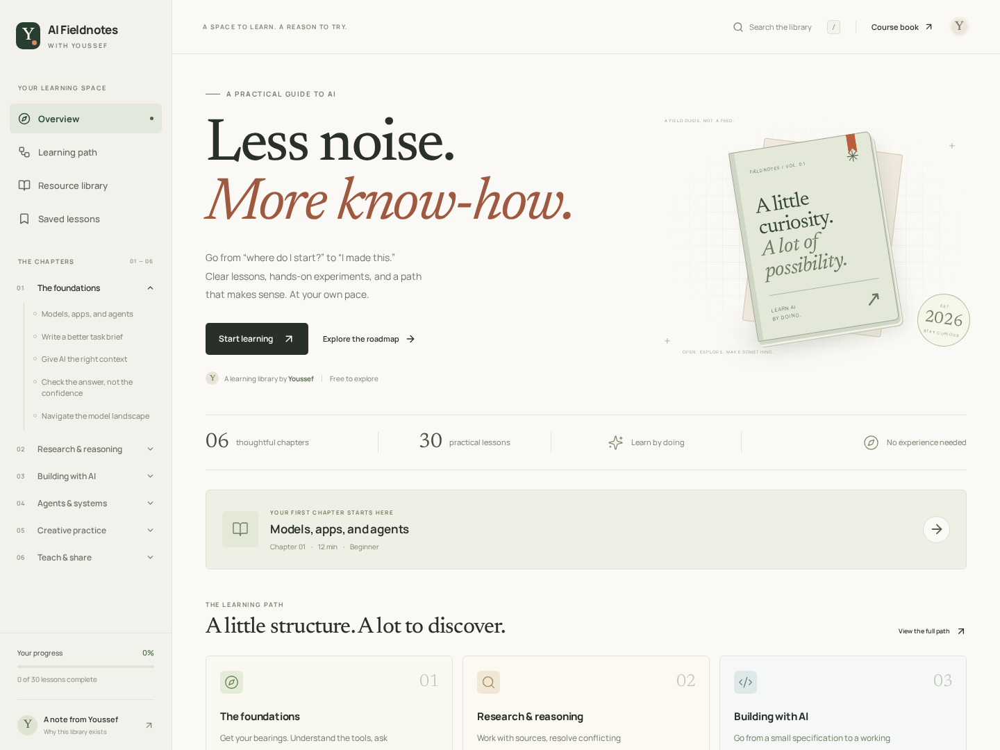

# AI Fieldnotes — a learning library by Youssef

A complete React course interface with **6 chapters, 30 Markdown lessons, 6 long-form resources, practice files, and a printable course book**. Built for a personal educational brand and prepared for GitHub.

The site is a static application: visitors can read, search, save lessons, take notes, and track progress without an account. Their learning data stays in their browser. Authors add content through files in the repository.



## Start the app

Use Node.js 22.12 or newer. From this project folder:

```bash
npm ci
npm run dev
```

Open the Local URL printed in the terminal. To produce a deployable build:

```bash
npm test
npm run build
npm run preview
```

The production site is in `dist/`. Dependencies are locked in `package-lock.json`; use `npm ci` for repeatable installations.

## Make the brand yours

Edit **[content/site.json](content/site.json)** for the library name, author, initials, tagline, and your real website/Instagram/GitHub links. Empty social links stay hidden. App and course-book branding read the same file.

Theme colors and typography live in `src/styles.css` and `src/styles-reader.css`. Fonts are bundled locally; readers do not need to contact a font service. Change the favicon in `public/favicon.svg`. Update the default title and description in `index.html` if you rename the library. A subtle design-skill attribution appears in the footer.

## The learning path

| Chapter | Focus | Lessons |
|---|---|---|
| 01 | Foundations: models, task briefs, context, checks, model landscape | 01–05 |
| 02 | Research: sources, conflicts, notebooks, data, comparisons | 06–10 |
| 03 | Building: debugging, specifications, apps, skills, verification | 11–15 |
| 04 | Systems: harnesses, bounded agents, handoffs, graphs, automation | 16–20 |
| 05 | Creative practice: images, edits, video, voice, consistent production | 21–25 |
| 06 | Teaching: lesson design, workshops, Instagram, evaluation, capstone | 26–30 |

The original research snapshot is **14 November 2026**; this course edition was organized **15 November 2026**. Current product claims need a new source check before being presented as current news. This project reorganizes the existing researched material; it does not claim that all the proposed experiments have been run.

The public-reader revision removes references to the authoring conversation. Lesson 05 and the guide's model section introduce ChatGPT, Claude, and Gemini, with a focused primary-source review dated **15 November 2026**. See the [release note](docs/releases/2026-11-15-public-reader-edit.md) and [source record](content/sources/05-the-model-landscape.md) for the scope.

## Add a lesson

```bash
npm run lesson:new -- --title "Your new lesson" --module research --minutes 15
```

The command creates a **draft** in `content/lessons/`. Fill in the content, research and test the claims, then change `status: "draft"` to `status: "published"`. Run `npm run content:check`, `npm test`, and `npm run build`. Restart the dev command or run `npm run content:build` to refresh generated content during development.

Published Markdown files are discovered automatically. You do not need to edit a React component or maintain a second lesson list. The same content drives the reader, search index, roadmap, downloads, and printable book.

## Files and documentation

```text
content/
  site.json                 Brand settings
  course.json               Chapter definitions and edition metadata
  lessons/*.md              Canonical course lessons
  resources/*.md            Longer references and templates
  sources/README.md         Evidence ledger instructions
docs/
  CONTENT-SYSTEM.md         File structure, metadata, adding material
  RESEARCH-AND-WRITING.md    How to research and write a lesson
  PDF-WORKFLOW.md           Produce matching printable editions
  WEBSITE-INTEGRATION.md    Connect this to your website later
  DEPLOYMENT.md             GitHub and static-host deployment
  BRAND-GUIDE.md            Visual and editorial conventions
  templates/                Lesson, research, experiment, release templates
scripts/
  build-content.mjs         Validate and build the content index
  build-book.mjs            Render the same lessons as printable HTML
  new-lesson.mjs            Create a structured draft
src/                        React interface and browser progress
public/downloads/           Practice kit and archive with public-reader revisions
tests/                      Content and browser acceptance tests
AGENTS.md                   Instructions for future AI collaborators
```

## Course book and PDFs

Use **Course book** in the app or open `course-book.html` in the built site. Choose **Print / Save as PDF**. You can also print one lesson from its reader toolbar. [PDF-WORKFLOW.md](docs/PDF-WORKFLOW.md) explains the consistent format and review process. The deliverable includes printable HTML; it does not include a separately typeset final PDF.

## Browser checks

The project includes Playwright acceptance tests for reading, persistent notes/progress, search, filters, downloads, the printable book, mobile navigation, and all lesson routes:

```bash
npx playwright install chromium
npm run test:browser
```

If you already have a compatible Chromium executable, set `PLAYWRIGHT_CHROMIUM_EXECUTABLE` instead of downloading another browser. `TEST_BASE_URL` can point tests at a running local build; the default test server uses port 5187. Test reports and screenshots stay ignored by Git.

## Publishing

The project is ready for you to push to your chosen repository. A GitHub Actions workflow validates and builds on pushes and pull requests. A separate Pages workflow deploys when you enable Pages and add the repository variable `DEPLOY_PAGES=true`. [DEPLOYMENT.md](docs/DEPLOYMENT.md) contains the steps and base-path settings.

No remote repository, live deployment, account system, database, or server upload service is created by this source package. Decide your code/content license before offering reuse; third-party materials and dependencies retain their own terms.
