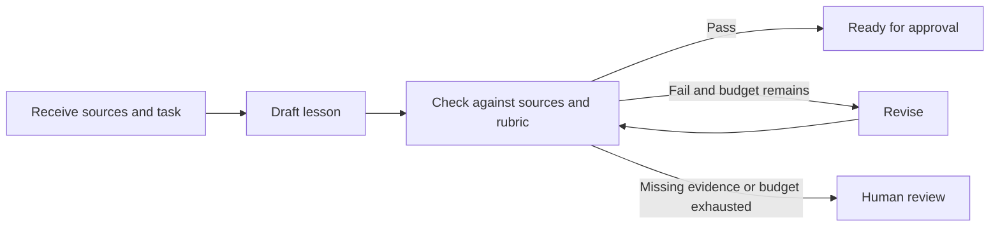

## The idea

Similar names can hide very different jobs. Grok is a model/product family. A workflow graph controls steps. A knowledge graph records relationships. Integration protocols connect systems. Learn the problem each one solves.

**Grok**, **LangGraph**, knowledge graphs, and graph-based media workflows serve different purposes. The similar names should be distinguished:

| Name | What it is | A suitable teaching example |
|---|---|---|
| **Grok** | A model and product family | Run the same evidence-based question in another model |
| **LangGraph** | A framework for stateful workflow/agent control | Draft → check → revise, with a stored state and conditional route |
| **Knowledge graph** | Entities connected by typed relationships | Lina → owns → Atlas Kit; Atlas Kit → launch date → 27 November |
| **GraphRAG** | A graph-based retrieval approach | Questions about relationships and themes across a document collection |
| **ComfyUI graph** | A node-based media workflow | Reference image → processing stages → generated result |

LangGraph's documentation emphasizes nodes, edges, state, persistence, and execution control. Microsoft GraphRAG builds graph-based representations and summaries for retrieval. They address different problems, and GraphRAG is not an automatic upgrade for every small notebook. [LangGraph overview](https://docs.langchain.com/oss/python/langgraph/overview) · [Microsoft GraphRAG](https://microsoft.github.io/graphrag/)

A small workflow graph could look like this. The check result and revision budget determine the route; the graph itself does not decide whether the lesson is factually correct.

A graph lesson can begin with paper and arrows. Only implement a framework once the diagram clarifies a real routing or relationship problem. In a small collection of three documents, ordinary source selection may be enough.

### Connections between systems

### 7.1 Agent Skills: package a repeatable procedure

The Agent Skills specification describes a folder containing `SKILL.md`, with metadata and task instructions, optionally accompanied by scripts, references, and assets. Compatible agents can discover the description first and load the full instructions when relevant. [Agent Skills overview](https://agentskills.io/home)

**Examples of reusable skills:**

- A company-research procedure that requires dated evidence for each important claim.
- A CRM cleanup procedure with duplicate rules and a preview of proposed changes.
- A frontend delivery procedure with visual checks and a consistent handoff.
- A content-production procedure that validates facts before adapting them to a script.

A skill provides procedural knowledge. It does not automatically grant access to an account or enforce a security boundary. Its instructions and any bundled code still need to suit the environment.

### 7.2 MCP: connect to tools and data

**Model Context Protocol** standardizes connections between AI applications and external systems, including data sources and tools. The protocol's documentation gives examples spanning calendars, databases, design tools, and other applications. [MCP introduction](https://modelcontextprotocol.io/docs/2026-07-28/getting-started/intro)

For a lead-research assistant, a skill could describe the research procedure, while an MCP connection supplies access to a permitted data source. You need both the instructions and the actual capability.

An available connector is also not a task instruction. The assistant should still follow the user's requested scope when deciding whether to read or change connected records.

### 7.3 ACP: connect the interface and the coding agent

**Agent Client Protocol** standardizes communication between coding agents and compatible editors or clients. Its current introduction covers local operation and notes that full remote support remains a work in progress. [ACP introduction](https://agentclientprotocol.com/get-started/introduction)

This helps explain why an interface can support several coding agents without being the implementation of every agent. Compatibility must still be checked against the particular client and agent.

### 7.4 A2A: connect agent applications

**Agent2Agent** addresses interoperability between agent applications. Its documentation distinguishes this from MCP connections to tools and data. [A2A documentation](https://a2a-protocol.org/latest/)

You do not need A2A just because you have two workers in one application. It becomes relevant when you want separately built agent services to discover capabilities and exchange tasks or results through a shared protocol.

| You want to connect… | Investigate… |
|---|---|
| An agent with reusable task knowledge | Agent Skills |
| An AI application with a CRM tool or data source | MCP or an appropriate direct integration |
| A coding client with a compatible coding agent | ACP |
| Independently built agent applications | A2A |

### 7.5 Code mode and programmatic tool use

Another practice is to let the agent write code that calls tools, filters large results, and returns a small answer. Anthropic's **November 4, 2025** MCP article explains how this can avoid moving every intermediate record through the model context. [Code execution with MCP](https://www.anthropic.com/research/code-execution-with-mcp)

**Worked example:** a report needs the count of qualified companies by industry. Code can fetch permitted records, apply the qualification rules, and calculate totals. The model can then explain the resulting small table. The runtime still needs clear access controls and the calculation must be inspectable.

### 7.6 CLI plus skills

Microsoft's current Playwright MCP repository explicitly discusses **CLI + Skills** as an alternative for coding agents, citing lower context overhead for some workflows. It also identifies cases where MCP's rich browser state is useful. This is a tool-design tradeoff, not a universal winner. [Playwright's comparison](https://github.com/microsoft/playwright-mcp#playwright-mcp-vs-playwright-cli)

**Selection principle:** choose the interface that gives the agent the needed capability with understandable inputs, concise outputs, and observable failures. Do not migrate a working integration solely because a different protocol is fashionable.

---

## Try it

**Time/access:** 25–40 minutes; paper or diagram tool; optional LangGraph implementation.

Draw intake → draft → check → approved. A failed check routes to revise; after two failed revisions route to human review. Define state fields: source IDs, draft, check results, revision count, and status.

**Check:** Walk a passing case, a failing case, and a missing-source case through the graph. Every path should stop or reach review. If implementing, test pause/resume rather than merely drawing a loop.

**Save/teach:** The graph and a trace through it. Explain state and conditional edges without presenting LangGraph as a model.

## Check your work

Walk a passing case, a revision case, and a missing-evidence case through your graph. Every path must reach a stop or review state.

Keep the [instructor answer key](#/resources/instructor-key) separate until you finish the attempt. Open the [full lab workbook](#/resources/practice-labs) for related exercises.

## Teach it

Use a simple graph to explain a decision, then identify which protocol or framework would be relevant.

## Keep exploring

Read the [complete field guide](#/resources/course-guide), use the [experiment log](#/resources/experiment-log), or explore the [technical agents companion](#/resources/agents-deep-dive). Product details reflect the research snapshot above; verify the primary links before presenting a current claim.
