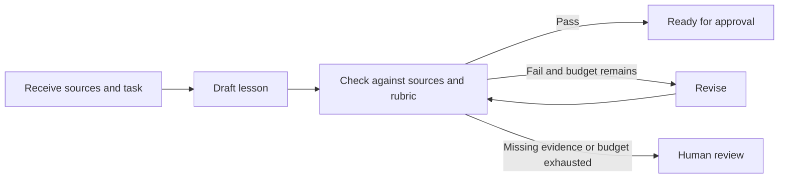

# AI from zero to advanced: a practical reboot

**Research snapshot: 14 November 2026. Model-family section reviewed 15 November 2026.**

Read alongside the [30 labs](02-practice-labs.md), [teaching playbook](03-instagram-and-teaching-playbook.md), and [agents deep dive](04-agents-deep-dive.md). Product statements below link to primary sources. The learning sequence and workflow recommendations are practical editorial guidance.

## 1. The map you need before the model names

AI literacy starts with knowing which part of a system you are using.

| Term | Plain explanation | Example of the distinction |
|---|---|---|
| Model | The trained system that interprets input and generates output | A model may understand an image without generating images |
| App | The interface and features around models | Search, files, voice, projects, and permissions can differ between apps using related models |
| API | A way for software to call a model or service | API billing and access can differ from a chat subscription |
| Tool | An operation available to the AI | Search, run a calculation, read a file, or create an image |
| Workflow | A defined sequence of steps | Form submission → classification → review queue |
| Agent | A system that chooses actions toward a goal, using tools and feedback | Inspect a repository, make a change, run checks, and report evidence |
| Harness | The surrounding execution system for an agent | Tool access, files, state, permissions, stopping conditions, and recovery |
| Orchestrator | Logic that coordinates models, agents, or steps | Route an easy ticket to a fast model and a difficult one to a stronger model |
| Context | Information available for the current work | Your instructions, documents, conversation, retrieved passages, and tool results |
| Memory | Information preserved and retrieved across work | A saved project decision or a durable preference |
| Evaluation | A repeatable check of whether a system does the intended job | Classify ten tickets against a known answer key |

These are working definitions for this curriculum. Products sometimes use the same words differently. When evaluating a tool, ask what it actually does: what it reads, what it can change, how it checks its work, and how you stop or resume it.

```text
Your outcome and success criteria
             ↓
App / workflow / agent harness
             ↓
Model ↔ context and tools
             ↓
Draft or action → checks → human decision
```

You can be highly capable without programming. You need programming or technical help when you want custom integrations, dependable automation, application development, or deeper control over model behavior. Begin with the user skill, then learn the implementation when it solves a real limitation.

## 2. Recent developments in practical AI

The useful catch-up story is a set of changes in how work is organized: models specialize by cost and difficulty; apps bundle tools; coding agents manage longer tasks; media tools edit existing material; and teams evaluate complete workflows rather than a single impressive response. This is a synthesis of the examples below, not a measurement of what every AI user does.

Selected recent checkpoints:

| Date | Verified development | What to learn from it |
|---|---|---|
| 21 September 2026 | Grok 4.7 release appears in the official API release notes | Model versions and product features need separate checking. [Release notes](https://docs.x.ai/developers/release-notes) |
| 28 September | ElevenLabs announced Eleven v4 and v4 Turbo | Voice quality and speed are separate evaluation dimensions. [Changelog](https://elevenlabs.io/docs/changelog/2026/9/28) |
| 29 September | OpenAI's API changelog records GPT-6.1 Sol and agent-related updates | Learn model selection alongside tools and execution. [API changelog](https://developers.openai.com/api/docs/changelog) |
| 13 October | Gemini 4 Argon developer access expanded following its earlier announcement | Announcement date and usable access date can differ. [Developer announcement](https://blog.google/innovation-and-ai/technology/developers-tools/build-with-gemini-4-argon/) |
| 29 October | Mistral Large 4's current version is listed as active | Check whether a preview or an older endpoint has been replaced. [Model record](https://legal.mistral.ai/ai-governance/models/mistral-large-4/) |
| 5 November | Gemini Omni 1.2 Flash model card was published | Multimodal input and generated audiovisual output are becoming part of one workflow. [Model card](https://deepmind.google/models/model-cards/gemini-omni-1-2-flash/) |
| 9 November | Anthropic introduced Fable 5.2 and Mythos 5.2 | Restricted access matters as much as capability claims. [Announcement](https://www.anthropic.com/claude-fable-and-mythos-5-2) |
| 10 November | Gemini 4 Carbon became more widely available | Longer, harder tasks have different latency and cost tradeoffs. [Release](https://blog.google/innovation-and-ai/models-and-research/gemini-models/gemini-4-carbon-now-available/) |
| 12 November, updated 13 November | Google introduced Gemini 4 Hydrogen | Fast execution and dynamic model routing deserve their own tests. [Announcement](https://blog.google/innovation-and-ai/models-and-research/gemini-models/introducing-gemini-4-hydrogen/) |
| 13 November | DeepSeek added application API features around search, files, URL reading, and voice | A useful app depends on services around the model. [Update](https://api-docs.deepseek.com/news/news261113/) |

This is a selected timeline, not a claim that the newest release is automatically the best choice. The strongest catch-up habit is to ask: **What changed in capability, access, price, or workflow—and can I demonstrate the difference?**

## 3. ChatGPT, Claude, Gemini, and other model families

AI assistants combine a model with an interface, tools, and access rules. Understanding those layers makes it easier to choose a product and interpret a comparison. Start with familiar assistants, then look at the models available inside each product.

### ChatGPT, Claude, and Gemini: the basic map

| Assistant | Provider | Model family | What to recognize |
|---|---|---|---|
| **ChatGPT** | OpenAI | GPT | ChatGPT is the application name; GPT names identify underlying models. |
| **Claude** | Anthropic | Claude | Claude names both an assistant and a model family, including Opus, Sonnet, and Haiku. |
| **Gemini** | Google | Gemini | Gemini names both Google's assistant and its model family. |

A model name alone does not describe the complete experience. File access, search, coding tools, subscriptions, and account permissions also affect what the assistant can do. The following model descriptions are provider positioning, not an independent ranking. Product access should be checked separately. [OpenAI product guide](https://learn.chatgpt.com/docs/models) · [Claude overview](https://claude.com/product/overview) · [Gemini release](https://blog.google/innovation-and-ai/models-and-research/gemini-models/introducing-gemini-4-hydrogen/)

### ChatGPT and OpenAI's GPT models

ChatGPT is a familiar starting point for working through questions, drafts, documents, and ideas. The model determines part of its behavior; the selected product and enabled tools determine the surrounding workflow. When comparing results, record both the application and the exact model shown.

OpenAI's API catalog lists these general-purpose options:

| Model | Provider positioning | Example task to evaluate |
|---|---|---|
| **GPT-6 Astra** | Demanding reasoning and complex work | Investigate a difficult problem and check the conclusions. |
| **GPT-6.1 Sol** | A balance of capability and cost | Produce a sourced brief or implement a scoped feature. |
| **GPT-6.1 Terra** | Visual reasoning, computer use, and clear writing | Interpret a screenshot or revise a document. |
| **GPT-6 Luna** | Efficient execution of focused, repeated tasks | Classify records or extract specified fields. |

These entries are drawn from the [OpenAI API catalog](https://developers.openai.com/api/docs/models). They are not a universal ChatGPT model-picker list. OpenAI's product guide distinguishes **Chat**, **Work**, and **Codex** availability. Check the current selection and limits in the actual product and account being used. [Product availability](https://learn.chatgpt.com/docs/models)

### Claude and Anthropic's model families

Claude is Anthropic's assistant and model family. The assistant provides a place to work with tasks and information; a selected Claude model supplies the underlying reasoning and generation. [Claude product overview](https://claude.com/product/overview)

| Model | Provider positioning | Example task to evaluate |
|---|---|---|
| **Claude Opus 5.5** | Substantial coding and knowledge work | Work through a complex document or debugging task. |
| **Claude Sonnet 5.5** | A balance of speed and capability | Draft, revise, or implement a well-defined change. |
| **Claude Haiku 5.5** | Fast, high-volume tasks | Classify tickets, extract fields, or route requests. |
| **Claude Fable 5.2** | Difficult reasoning and longer technical projects | Investigate a problem that simpler approaches have not solved. |

Anthropic's model guide recommends Opus as a general starting point and Fable for more demanding work. These are provider recommendations to test on representative tasks. [Claude model overview](https://platform.claude.com/docs/en/models/overview)

**Claude Mythos 5.2** has a different access arrangement: Anthropic describes verification programs for qualifying cybersecurity and life-sciences work. Its availability should not be assumed from the public Claude model list. [Fable and Mythos announcement](https://www.anthropic.com/claude-fable-and-mythos-5-2)

### Gemini and Google's model families

Gemini is Google's assistant and model family. The Gemini 4 lineup includes three names with different intended roles:

| Model | Provider positioning | Example task to evaluate |
|---|---|---|
| **Gemini 4 Argon** | Broad software and knowledge work | Create a document brief or fix a scoped bug. |
| **Gemini 4 Carbon** | More demanding, sustained reasoning | Investigate difficult debugging or research questions. |
| **Gemini 4 Hydrogen** | Fast execution and everyday workflows | Classify records, rewrite text, or complete smaller workflow steps. |

Google's announcements describe these roles and model routing in Antigravity. Access varies across the Gemini app, developer tools, subscriptions, and API. [Carbon and Argon positioning](https://blog.google/innovation-and-ai/models-and-research/gemini-models/gemini-4-carbon-now-available/) · [Hydrogen and routing](https://blog.google/innovation-and-ai/models-and-research/gemini-models/introducing-gemini-4-hydrogen/)

### Other model families worth recognizing

The wider reading list also covers **Grok**, **DeepSeek**, **Qwen**, and **Mistral**. Their interfaces, deployment options, licenses, and tool support differ. Consult their current documentation before selecting a version: [Grok](https://docs.x.ai/developers/models/grok-4.7), [DeepSeek](https://api-docs.deepseek.com/updates/), [Qwen](https://github.com/QwenLM/Qwen3.8), and [Mistral](https://mistral.ai/news/mistral-large-4-oss/).

### How to choose a model in practice

Begin with a task and a success check. Compare candidates on:

1. **Correctness:** Does the result meet the requirements?
2. **Evidence:** Can important claims be traced to reliable sources?
3. **Instruction following:** Are the required format and constraints preserved?
4. **Time:** How long does a usable result take, including corrections?
5. **Cost:** What does the full attempt cost, including retries and tools?
6. **Workflow fit:** Can the product access the inputs and perform the required operations?

For example, give two assistants the same short document and request five facts with source locations. Check missing information and unsupported additions as well as fluency. Record tool access so the comparison describes the setup accurately.

Start with accessible options and a small task set. Add another provider when it answers a concrete question about quality, speed, cost, or workflow. Model choice should follow the work being evaluated. [OpenAI model-selection guidance](https://learn.chatgpt.com/docs/model-selection)

## 4. The human skills worth learning first

“Best skills” has two meanings: abilities you develop and reusable instructions installed in an agent. Start with your own abilities; section 12 covers installable skills.

| Suggested priority | Human skill | Evidence you have learned it |
|---|---|---|
| 1 | Define the job | You can state the input, output, constraints, and success check in one short brief |
| 2 | Verify claims and outputs | You detect the wrong date, unsupported promise, arithmetic error, or broken feature |
| 3 | Supply useful context | You choose the relevant documents and identify which decision is authoritative |
| 4 | Design small experiments | You change one variable and keep a record of the result |
| 5 | Structure information | You can request a stable table or schema and check every required field |
| 6 | Research with sources | You distinguish a primary source, a vendor claim, and your own interpretation |
| 7 | Direct and edit media | You specify the subject, composition, text, continuity, and change to make |
| 8 | Work with data and code | You can inspect a calculation or run an acceptance check instead of trusting a fluent explanation |
| 9 | Build a repeatable workflow | You can handle an ordinary case, an exception, and a failed step |
| 10 | Teach from evidence | A learner can repeat your process without relying on your live intervention |

This is a recommended order for a creator and mentor, not a claim about a universal curriculum. Your technical students may move into coding earlier; a designer may spend more time on media control.

Being advanced means you can choose the smallest effective system, diagnose a failure, and explain its limits. Adding more agents, longer prompts, or more expensive models does not by itself demonstrate mastery.

## 5. Prompting and context: the techniques that transfer

Start with a task brief that makes the result inspectable.

```text
Outcome: What useful result do I need?
Audience: Who will use it, and what do they already know?
Inputs: Which material should you use?
Authority: Which source wins if inputs conflict?
Constraints: What must be included, preserved, or excluded?
Output: What format should the result take?
Checks: How will I judge it?
Uncertainty: What should you leave unresolved or ask about?
```

For example, “write me a good AI video” leaves almost every important decision open. A better brief is: “Create a 60-second beginner explanation of model versus app. Use one contact-cleaning example. Include a visible failure and a check. Avoid claims about a universal best model. Deliver narration and a shot list.” The duration here is an editorial choice, not a platform limit.

Useful techniques to practice:

- **Provide examples of the target output.** One accepted example and one rejected example can clarify a subjective request.
- **Separate source material from instructions.** Mark the supplied customer text as data and specify what to extract from it.
- **Define the authority order.** An approved decision should outrank an older proposal; a newer informal note is not automatically authoritative.
- **Request an evidence table.** Ask for the claim, source, supporting passage or location, and unresolved gaps.
- **Draft, inspect, revise.** Name the defect you want changed and the elements that must stay fixed.
- **Ask for a plan when the task has dependencies.** Skip elaborate planning for a one-sentence rewrite.
- **Use external checks.** A calculator, schema validator, test runner, or source document can catch errors a second opinion may repeat.
- **Save a compact handoff.** Record completed work, verified facts, open questions, file locations, and the next action before continuing elsewhere.

Ask for concise reasons, assumptions, calculations, and verification evidence. You do not need a model's private internal reasoning to judge a result. A long explanation can still be wrong.

Context engineering is the practical work of deciding what information is supplied, retrieved, retained, summarized, and removed. More material is useful only if the right facts remain findable. In Lab 4 you will test whether an AI can resolve three conflicting documents; simply pasting them all is not the complete skill.

Three original templates:

```text
RESEARCH BRIEF
Answer [question] as of [date]. Prefer primary sources.
Separate verified facts, vendor claims, and your interpretation.
For each important claim, supply a direct source and its date.
If sources conflict, explain which one governs and why.
End with what remains unknown and what I could test myself.
```

```text
CONTROLLED EDIT
Change [one named element] in [artifact].
Preserve [list of invariants].
Show the revised result and identify any requested element you
could not preserve. I will compare it against the original.
```

```text
BOUNDED AGENT TASK
Produce [deliverable] using [working folder and permitted tools].
Success means [observable checks].
Keep a short progress record and identify unresolved blockers.
Stop after [time, cost, or action budget] or when checks pass.
Prepare external messages or publication as drafts unless authorized.
Return the changed artifacts and the evidence from your checks.
```

Treat templates as starting points. If a task already specifies everything clearly, adding a long ritual can make it harder to understand.

## 6. Research, notebooks, RAG, and knowledge

There are three different research jobs:

1. **Discover:** Find relevant sources you did not already have.
2. **Understand:** Summarize, compare, and question a selected collection.
3. **Verify:** Open the source and confirm that it supports the exact claim.

A web-search assistant may help with discovery. A source-grounded notebook helps explore a selected collection. Neither removes the final verification job. Perplexity documents search/research features; Google's current help pages describe Gemini Notebook, a name you may encounter alongside NotebookLM. [Perplexity product guide](https://www.perplexity.ai/help-center/en/articles/11187416-which-perplexity-subscription-plan-is-right-for-you) · [Notebook help](https://support.google.com/gemininotebook/answer/16215270?hl=en)

**RAG**, retrieval-augmented generation, means retrieving relevant information and supplying it when generating an answer. It is useful when the answer depends on a document collection. The retrieved material can still be incomplete, stale, or misleading. OpenAI's retrieval documentation describes searching indexed files; assess retrieval quality separately from how well the model writes. [Retrieval guide](https://developers.openai.com/api/docs/guides/retrieval)

Do not confuse these mechanisms:

| Mechanism | Main job | First test |
|---|---|---|
| Context | Make information available now | Can the model use the correct passage in this task? |
| Memory | Preserve and retrieve useful information across work | Does it retain the right decision and update it when superseded? |
| RAG | Fetch relevant material from a collection | Did retrieval include the evidence needed to answer? |
| Fine-tuning | Adapt model behavior using training examples | Does it improve a measured repeated behavior on held-out examples? |

For a beginner business knowledge assistant, start with a small, clean source collection and known-answer questions. Do not start with fine-tuning merely because you want the AI to “know my business.” You first need to discover whether the problem is missing evidence, bad retrieval, conflicting policies, or behavior that truly needs adaptation.

For a teaching video, demonstrate the approved launch fixture. Show the old date, the approved date, and the missing refund policy. The lesson is stronger when viewers see both an answer and a justified refusal to invent missing information.

## 7. Files, spreadsheets, and structured outputs

This is a high-value area because a result can often be checked precisely. Practice turning messy input into a small useful output: an expense table, ticket classification, document comparison, or course outline.

The essential sequence is:

1. Inspect the input and define the meaning of each field.
2. State the calculation or classification rule.
3. Request the output format.
4. Check totals, identities, exclusions, and missing values.
5. Explain the result in the user's language.

In the supplied orders fixture, a discount is a fixed amount per order. Applying it per unit changes the answer. Refunded, pending, and cancelled rows are excluded by the exercise's rule. The correct paid net total is **USD 890**. This is a fictional calculation exercise, not an accounting policy.

Structured output means an answer follows a defined shape, such as a JSON object with required fields and allowed categories. A compatible API can enforce a supported schema, but a valid structure can contain a wrong classification or invented fact. Verify the content separately. [Structured outputs](https://developers.openai.com/api/docs/guides/structured-outputs)

For teaching, show two independent dimensions: “Can my program parse it?” and “Is it right?” Lab 6 includes a customer message containing an instruction to change the task. The desired behavior is to classify that message, not follow it. A prompt boundary is useful, but a dependable automation also limits what the tool can actually change.

## 8. Coding and building with AI

Start with a tiny application or bug where success is visible. You should understand the input, the expected behavior, and the way to run it. You do not have to write every line yourself, but you do need a route to detecting failure.

An effective coding session has five artifacts:

- A short specification.
- The relevant code and reproduction steps.
- A limited change.
- Evidence from meaningful checks.
- A plain-language explanation of what changed and what remains uncertain.

The supplied contact-cleaning bug is deliberately small. Both the buggy and correct versions return **four contacts**, but the buggy version retains the wrong Ada record and drops Cora. A count-only test passes while behavior is wrong. This is an excellent first lesson in evaluating AI-generated code.

For a larger project, ask the agent to inspect the existing design before editing, implement one useful slice, and show the checks. Keep the task small enough to review. A polished preview does not establish that persistence, authentication, accessibility, or error handling works.

Tools fall into different layers: an editor integrates code work; a coding agent executes tasks; an interface can supervise several agents; a framework provides application building blocks. **T3 Code** is an open-source interface/control plane for coding agents, distinct from T3 Chat and the T3 web-development stack. Its repository is the appropriate place to check current provider support. [T3 Code](https://github.com/pingdotgg/t3code)

Your first advanced coding trick should be a reliable reproduction and acceptance check. Parallel work, worktrees, and long autonomous loops become useful after you can tell whether one worker succeeded. See the [technical companion](04-agents-deep-dive.md) for those patterns.

## 9. Images, video, and voice: learn control, not just generation

### Images

An image brief should describe the subject, composition, intended use, important text, and constraints. Then test a controlled edit. Keeping a layout while changing one object is a different ability from generating a fresh attractive picture.

Current examples to investigate include **GPT-Image-2.6 Flare and Sunburst**, with different speed/detail positioning, and **Nano Banana 2.1**, whose model card is dated 6 October. Check the exact model and editing controls exposed in your app. [OpenAI image guide](https://developers.openai.com/api/docs/guides/image-prompting?model=gpt-image-2.6) · [Nano Banana model card](https://deepmind.google/models/model-cards/nano-banana-2-1/)

For the supplied cover exercise, inspect whether the headline is exact, appears once, and remains unchanged when the notebook changes color. If text rendering fails, a practical alternative is generating the background and adding the final typography in an editor. Record the extra editing time when comparing workflows.

### Video

Break a clip into subject, action, setting, camera movement, duration, and continuity constraints. Use a short shot to discover failure modes before attempting a complex sequence. A model may understand a reference video without supporting every kind of edit you want.

Two current examples are **Gemini Omni 1.2 Flash**, documented with multimodal input and audiovisual output, and Runway's **Gen-4.5** generation and **Aleph 2.0** editing offerings. These are different entry points into production; compare the relevant operation rather than declaring a single winner from a trailer. [Omni model card](https://deepmind.google/models/model-cards/gemini-omni-1-2-flash/) · [Runway model catalog](https://docs.dev.runwayml.com/guides/models/)

For the notebook clip, score continuity, hand movement, action completion, unintended text, and whether the requested edit preserves the original action. View the full clip at normal speed and inspect problem frames. Log every generation, not only the selected result.

**ComfyUI** represents a different workflow: a node graph connects media-processing components. It is useful to study when you want visible control over stages and repeatable configurations. It is not a language model or a synonym for LangGraph. [Official repository](https://github.com/Comfy-Org/ComfyUI)

### Voice and audio

Distinguish transcription, generated speech, and live conversation. Transcription turns recorded speech into text; speech generation reads text; a live voice system manages an ongoing exchange and may delegate work to tools.

Current examples include **Eleven v4/v4 Turbo** for speech and OpenAI's **GPT-Live** conversation system. OpenAI's live guide describes a voice model working with a backend agent for reasoning and tools. [ElevenLabs announcement](https://elevenlabs.io/docs/changelog/2026/9/28) · [Live guide](https://developers.openai.com/api/docs/guides/live)

Test dates, names, prices, pauses, and corrections. Test the languages and code-switching patterns the intended audience uses, and record the language and recording conditions. Use your own voice or an appropriately licensed voice. A convincing voice is not evidence that a spoken claim is correct.

## 10. Automation, agents, harnesses, and orchestration

An automation repeats a defined process. An agent can choose some of the next steps. Many useful systems combine both: fixed intake and logging, an AI classification or research step, then a controlled review or action.

Example: new lesson request → check required fields → classify topic → draft lesson → validate required sections → teacher reviews → publish. The AI is one component of the process.

Workflow tools such as **n8n** document combining AI agents and ordinary workflow steps. The important skill is designing input validation, tool access, exceptions, logs, and a stop or review point. [n8n agent workflows](https://n8n.io/ai-agents/)

When should you use each pattern?

| Pattern | Good first use | Failure to watch |
|---|---|---|
| One prompt | A bounded transformation | Missing context or ambiguous instructions |
| Fixed workflow | A repeated process with known stages | Unhandled exceptions or brittle assumptions |
| One agent | The route needs tool-based exploration | Unbounded action or weak success criteria |
| Subagent | A separable task needs its own context | Duplicated work and lost information during handoff |
| Orchestrator | Several workers or models need coordination | Coordination costs more than the work it saves |
| Long-running loop | Repeated attempts can be checked objectively | A weak check lets the loop repeat or optimize the wrong thing |

These are design recommendations. Start by proving that the simpler pattern is insufficient on a real task.

An agent needs an operating environment: tools, working files, feedback, and boundaries. That is why **harness engineering** matters alongside model selection. A subagent needs a bounded assignment and a useful handoff. An orchestrator needs a way to decide what runs, combine results, resolve conflicts, and stop.

Other names worth recognizing are **Ralph** loops, **GSD** structured development, **Git worktrees**, **MCP**, **ACP**, and **A2A**. They refer to different things: execution patterns, project processes, workspace isolation, and integration protocols. The [agents companion](04-agents-deep-dive.md) explains each with dated primary sources and worked examples. Learn the problem each solves before installing it.

For your first agent demonstration, let an agent inspect the supplied documents and draft a brief in a working folder. Keep the result reviewable. Do not begin by letting a new setup send messages, modify customer records, or publish lessons automatically; those actions add operational decisions unrelated to understanding the basic loop.

## 11. “Graph”: four meanings you may encounter

**Grok**, **LangGraph**, knowledge graphs, and graph-based media workflows serve different purposes. The similar names should be distinguished:

| Name | What it is | A suitable teaching example |
|---|---|---|
| **Grok** | A model and product family | Run the same evidence-based question in another model |
| **LangGraph** | A framework for stateful workflow/agent control | Draft → check → revise, with a stored state and conditional route |
| **Knowledge graph** | Entities connected by typed relationships | Lina → owns → Atlas Kit; Atlas Kit → launch date → 27 November |
| **GraphRAG** | A graph-based retrieval approach | Questions about relationships and themes across a document collection |
| **ComfyUI graph** | A node-based media workflow | Reference image → processing stages → generated result |

LangGraph's documentation emphasizes nodes, edges, state, persistence, and execution control. Microsoft GraphRAG builds graph-based representations and summaries for retrieval. They address different problems, and GraphRAG is not an automatic upgrade for every small notebook. [LangGraph overview](https://docs.langchain.com/oss/python/langgraph/overview) · [Microsoft GraphRAG](https://microsoft.github.io/graphrag/)

A small workflow graph could look like this. The check result and revision budget determine the route; the graph itself does not decide whether the lesson is factually correct.



A graph lesson can begin with paper and arrows. Only implement a framework once the diagram clarifies a real routing or relationship problem. In a small collection of three documents, ordinary source selection may be enough.

## 12. Installable Agent Skills: what to choose and how to judge them

An Agent Skill is a reusable package of instructions and, sometimes, references or executable resources. The Agent Skills specification uses a `SKILL.md` entry point. Support and behavior depend on the host application. A skill can guide a process; it does not replace missing tools or establish that the result is correct. [Agent Skills](https://agentskills.io/home)

A useful skill improves a repeated task with an observable success check. The following candidates illustrate different uses:

| Candidate | Why it may help | Test before adopting |
|---|---|---|
| Document skills: PDF, DOCX, PPTX, XLSX | Creating and inspecting teaching materials | Does the exported file open, preserve the required content, and render correctly? [Anthropic examples](https://github.com/anthropics/skills) |
| Frontend design | Moving from a vague page request to intentional visual design | Can learners use it on mobile and find the main action? [Skill source](https://github.com/anthropics/skills/blob/main/skills/frontend-design/SKILL.md) |
| Webapp testing | Checking a real browser flow | Does it reproduce the bug and verify the changed behavior? [Skill source](https://github.com/anthropics/skills/blob/main/skills/webapp-testing/SKILL.md) |
| Systematic debugging | Finding a cause before making broad changes | Does it identify the contact bug with evidence? [Superpowers](https://github.com/obra/superpowers) |
| Verification before completion | Connecting a completion claim to a real check | Does the final report include the actual check and its result? [Superpowers](https://github.com/obra/superpowers) |
| Planning and code-review skills | Structuring work and exposing assumptions | Does review find a meaningful defect, and does planning reduce rework? [Superpowers](https://github.com/obra/superpowers) |
| React best practices | Improving relevant React implementations | Does it help the specific codebase and measured problem? [Vercel skills](https://github.com/vercel-labs/agent-skills) |
| Web design guidelines | Reviewing interface quality | Can you reproduce its findings and verify the fix? [Vercel skills](https://github.com/vercel-labs/agent-skills) |
| Writing guidelines | Keeping public material clear and consistent | Does it improve a draft against your rubric without changing facts? [Vercel skills](https://github.com/vercel-labs/agent-skills) |
| A personal research-to-lesson skill | Reusing your evidence and teaching format | Can it create a sourced draft without inventing experiments? Create it only after a few manual runs |

This is a curated shortlist, not a hands-on ranking. Inspect what a package asks the agent to do and whether it includes scripts, network access, or installation steps. Test on a copy of a small project. Avoid installing several overlapping process frameworks at once; you will struggle to identify which change helped.

**A current migration to notice:** OpenAI's old `openai/skills` repository marks itself deprecated and points to `openai/plugins`. Use the current destination when researching that ecosystem. The terms skill, plugin, and connector are related but not interchangeable: a plugin may bundle skills and tools, while a connector provides access to a service. [Migration notice](https://github.com/openai/skills) · [Current repository](https://github.com/openai/plugins) · [Plugin documentation](https://developers.openai.com/plugins/build/plugins)

For a future personal skill, record your audience, source rules, lesson structure, evaluation rubric, and known failure cases. Keep rapidly changing model names in a dated reference rather than embedding them as timeless instructions.

## 13. Advanced topics worth knowing without learning them all at once

| Topic | Why people use it | Your first sensible experiment |
|---|---|---|
| Routing | Match cost/capability to the difficulty of a step | Fast model for labels, stronger model for disputed cases |
| Caching and batching | Reduce repeated processing or improve throughput | Measure a repeated task with the provider's supported mechanism |
| Local inference | Control deployment and operate on suitable local hardware | Run a small compatible model after checking memory and license requirements |
| Quantization | Reduce model memory requirements, with tradeoffs | Compare the same task and record quality, speed, and memory |
| Fine-tuning | Adapt repeated behavior using examples | Establish a baseline and held-out evaluation first |
| Tool calling | Let a model request an external operation | A read-only calculation or lookup with validated arguments |
| Code-based tool use | Compose operations through code | A small file transformation with visible inputs and outputs |
| Persistent agents | Resume work across time and interruptions | Save a progress record and test a supervised resume |
| Tracing and evals | Diagnose failures across multiple steps | Log retrieval, model output, checks, and final disposition |
| Computer use | Operate an interface through an agent | A reversible task in a test environment with an observable outcome |

These are learning directions, not recommendations to implement everything. If a term does not solve a problem you currently have, recognition is sufficient.

**Open weights** means weights are available under a particular license. It does not imply that every model fits your laptop or that every commercial use is unrestricted. Qwen's repository lists markedly different model sizes. Mistral Large 4 uses its specified open-weight license, including particular hosting terms. Check the exact model card and license for the use you intend. [Qwen repository](https://github.com/QwenLM/Qwen3.8) · [Mistral release and license](https://mistral.ai/news/mistral-large-4-oss/)

For a creator teaching beginners, high-level awareness of robotics and world models can be useful news coverage. They need not enter your first practical course unless you can offer learners access, a reproducible task, and a credible way to judge the result.

## 14. What capable users actually do differently

The following habits are recommended practice patterns, not a survey of all AI users:

- They keep a task library with real examples and known checks.
- They give the AI access to the relevant material rather than repeatedly describing it from memory.
- They separate generation from verification, using external evidence where possible.
- They maintain a small collection of reusable briefs instead of collecting hundreds of untested prompts.
- They compare complete workflows, including cleanup, retries, and review time.
- They record a failure and improve the process instead of silently hiding it.
- They use a stronger model at a difficult bottleneck when the experiment justifies it.
- They preserve decisions and progress in readable artifacts for future sessions.
- They automate a stable manual procedure after understanding its exceptions.
- They can explain which part of a result came from AI, a tool, a source, or human editing.

An impressive demonstration is one successful run. A dependable method requires repeated success on representative inputs and a clear response to failures. For a small introductory comparison, three fresh attempts per candidate can expose variability; it does not establish broad statistical superiority.

The best “trick” is to make the work checkable. Give the model a small task, a clear rule, appropriate context, and feedback. Change one variable at a time. Save what you learn.

## 15. Your learning route and readiness to teach

Use the six-week plan in the [teaching playbook](03-instagram-and-teaching-playbook.md). It is a suggested schedule; take longer when a mastery check fails.

Before teaching a topic, you should be able to:

1. Explain it in plain language without a vendor slogan.
2. Complete a relevant task yourself.
3. Demonstrate a failure or limitation and a check that detects it.
4. State the model, app, access level, and date used in your demo.
5. Give learners a small exercise and evaluate their result fairly.
6. Distinguish your observation from a vendor claim and an untested idea.

Teaching readiness comes from a reliable process: clear foundations, tested examples, and the ability to investigate unfamiliar cases. State the scope and limits of each experiment.

For weekly updates, maintain a simple registry: product, exact version, change date, availability, official source, your test, result, and next review date. Prioritize changes that affect a lesson or workflow. A renamed button is less important than a changed access restriction, retired endpoint, new editing capability, or altered cost.

Your next action is practical: complete the first three labs, save the evidence, and explain one result to a learner. Build the next lesson from what the learner could reproduce.
