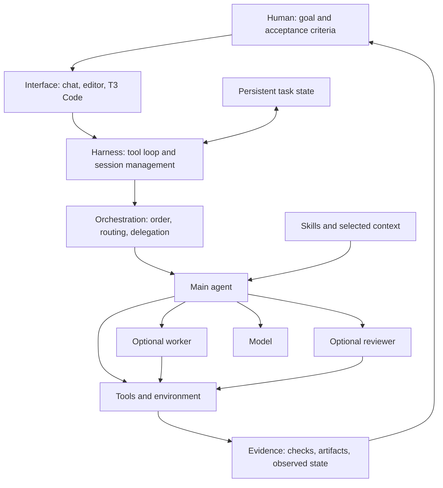

# How people are working with AI agents now

## Harnesses, T3 Code, subagents, orchestrators, and the workflows around them

**AI Fieldnotes · Research snapshot: 14 November 2026**  
**Scope:** practical AI use for software, products, research, CRM work, and content. Recent news focuses on 7–14 November; older foundations carry their original dates. Living documentation was checked on 14 November.

**Length:** approximately 8,200 words, including tables, prompts, and the source guide. Allow about 35–45 minutes for a full read, or use the routes below.

The most useful development is the ability to give AI a working environment, a clear assignment, and a way to check its result. That changes the human's work: you spend more time defining outcomes, supplying context, reviewing evidence, and improving the process when it fails.

This guide explains harnesses, T3 Code, subagents, and orchestration through documented examples and practical workflows. **T3 Code** is an interface for coding agents; T3 Chat and the T3 web-development stack are separate products.

**How to read the evidence:** a product's documentation establishes a capability; a vendor benchmark establishes what that vendor reports; a developer's account establishes their experience. None alone establishes how most developers work. Recommendations and worked examples are editorial guidance rather than measured results. This is a researched guide, not a hands-on benchmark of every tool.

### Reading routes

- **Understand the architecture:** [harnesses](#1-harness-the-system-that-lets-a-model-do-work), [T3 Code](#2-t3-code-an-interface-for-controlling-coding-agents), [subagents](#3-subagents-giving-a-bounded-job-its-own-context), [orchestrators](#4-orchestrators-deciding-what-runs-and-who-owns-the-result), and [the complete stack](#5-how-the-layers-fit-together).
- **Learn the methods:** [context and memory](#6-context-memory-and-long-running-work), [skills and protocols](#7-skills-mcp-acp-a2a-and-code-based-tool-use), [execution patterns](#8-execution-methods-people-combine-with-agents), and [choosing an architecture](#9-choosing-one-agent-several-agents-or-a-fixed-workflow).
- **See what people actually do:** [documented examples](#10-what-people-are-actually-doing).
- **Catch up on recent news:** [dated developments](#11-recent-ai-developments-relevant-to-these-methods).
- **Choose tools and explore workflows:** [tools](#12-which-tools-belong-to-which-problem), [three worked workflows](#13-three-practical-workflow-examples), [cost and reliability](#14-cost-reliability-and-the-mistakes-to-watch), and [a learning path](#15-a-seven-day-learning-path).
- **Copy a useful task brief:** [prompt templates](#16-reusable-briefs-to-try).

---

## 1. Harness: the system that lets a model do work

A **model** generates responses. An **agent harness** supplies the machinery around it: the loop that processes those responses, tools it can call, working files, state, and controls over execution. LangChain's March 10, 2026 architecture article treats prompts, tools, infrastructure, orchestration, and lifecycle logic as parts of this surrounding system. [Harness anatomy](https://www.langchain.com/blog/the-anatomy-of-an-agent-harness)

Consider the instruction: “Fix the duplicate-contact bug in this CRM.”

To complete that assignment, the agent needs access to the repository, a way to locate the relevant code, permission to edit, a runnable application, and evidence that the duplicate is gone. The model's intelligence helps choose the actions. The harness makes the actions possible and returns their results.

```text
Your goal and acceptance criteria
                ↓
         Agent harness
   ┌──────────────────────────┐
   │ Model ↔ tools ↔ feedback  │
   │ Context and session state│
   │ Execution controls      │
   └──────────────────────────┘
                ↓
      Files, browser, APIs,
      databases, test results
                ↓
       Reviewable deliverable
```

### Harness engineering

**Harness engineering** means improving that environment so the agent succeeds more consistently. In his February 5, 2026 account, Mitchell Hashimoto describes improving project instructions and creating verification tools in response to repeated agent mistakes. He also describes learning which tasks were worth delegating. This is a practitioner's account, rather than a controlled productivity study. [My AI Adoption Journey](https://mitchellh.com/writing/my-ai-adoption-journey)

**Worked example: an improvement loop**

| Repeated problem | Change to the working environment | Evidence of improvement |
|---|---|---|
| Agent runs the wrong test command | Document the actual command beside the project setup | A fresh session runs the correct check |
| Agent declares a visual change finished without opening it | Provide a browser verification procedure | The handoff includes inspected screenshots |
| Agent repeatedly recreates an existing utility | Add a short architecture index linking to the utility | New work reuses the existing implementation |
| Agent forgets what happened in a long task | Save a compact state and next-step note | Another session resumes without reconstructing everything |
| Agent overwrites another worker's edits | Assign ownership and separate workspaces | Integration preserves both changes |

The point is to convert an observed failure into a repeatable improvement. A longer instruction file is only useful when the added information changes behavior.

### Agent harness versus evaluation harness

The **agent harness** runs the worker. An **evaluation harness** runs tasks, collects traces, grades outcomes, and compares runs. Anthropic explicitly distinguishes these terms in its January 9, 2026 evaluation guide. Both matter: one produces the work, the other measures how reliably it succeeds. [Evaluation terminology](https://www.anthropic.com/research/demystifying-evals-for-ai-agents)

### Inner and outer layers

A useful distinction for your own setup is between the runtime you receive from an agent product and the project-specific practices you add around it. You may have little reason to replace the runtime. You can still improve setup instructions, task briefs, reusable procedures, and verification. This is a practical way to begin harness engineering without building a new coding agent.

---

## 2. T3 Code: an interface for controlling coding agents

**T3 Code describes itself as an open-source control plane for coding agents.** Its current repository documents support for agents including Claude Code, Codex, OpenCode, and ACP-compatible agents. It runs agents on your machine, offers desktop/web/mobile access, supports per-thread Git worktrees, and drives existing authenticated providers. It does not resell tokens. Its code is MIT licensed. [Official repository](https://github.com/pingdotgg/t3code)

That places it above the individual coding agents in the stack:

```text
You
 ↓
T3 Code interface
 ↓
Configured coding agent and its harness
 ↓
Model provider + working environment
```

An interface can expose coordination features, but installing an interface does not by itself create a good delegation strategy. You still need to decide which tasks are independent, who owns each change, and how to accept the result.

### What is new

The **14 November nightly prerelease**, `v0.1.10-nightly.20261114.4682`, includes native resumption of stopped Claude, Codex, and OpenCode threads, faster usage summaries, and fixes around file editing and queued edits. These are prerelease changes; they should not be assumed to be in the stable release. [Exact release](https://github.com/pingdotgg/t3code/releases/tag/v0.1.10-nightly.20261114.4682)

### How to evaluate the interface

Try the same small task in your existing interface and in T3 Code. Assess whether it reduces the effort of finding sessions, inspecting changes, continuing work, or switching between already-configured agents. Keep the underlying task and checks the same. An attractive interface is useful when it removes a real bottleneck in your day.

Before committing to it, check your required provider's support, authentication, usage accounting, and permission behavior. A shared interface does not make provider subscriptions, context handling, or model access identical.

---

## 3. Subagents: giving a bounded job its own context

A **subagent** is a worker invoked by another agent for a defined assignment. OpenAI's current managed-agent documentation describes independent contexts, parallel execution, and a coordinating main agent. It recommends independent assignments and coordination when workers edit the same files. This is a documented capability, not a claim about a new release this week. [OpenAI multi-agent documentation](https://developers.openai.com/api/docs/guides/agents-api/multi-agent)

The important property is **context separation**. An investigation can produce thousands of lines of logs or source excerpts. A worker can inspect those and return the few findings that matter, preserving room in the main conversation for the overall task.

Claude Code's documentation likewise describes specialized workers with their own context, prompts, tool access, and permissions. Their requests still count toward usage limits. “Separate context” therefore does not mean “free work.” [Claude Code subagents](https://code.claude.com/docs/en/sub-agents)

### A useful assignment

For a CRM import issue, the main agent could ask:

- Worker A: locate the import validation rules and report why duplicate rows pass.
- Worker B: inspect the existing duplicate-related tests and identify missing cases.
- Main agent: compare the evidence, choose the fix, implement it, and verify the integrated behavior.

These investigations can be independent. Asking one worker to design a new database schema while another writes code against the old schema creates a dependency that must be resolved first.

### What belongs in a worker brief

**Proposed brief format:**

| Field | Example |
|---|---|
| Objective | Explain why duplicate contacts survive an import |
| Inputs | Import implementation, relevant tests, sample duplicate rows |
| Scope | Investigate; leave files unchanged |
| Deliverable | Ranked causes with file locations and a reproduction |
| Evidence | Actual code paths and observed results |
| Stop condition | One supported explanation, or a clear statement of missing evidence |

A job title such as “expert backend engineer” communicates much less than this contract.

### Subagent, parallel session, and team are different choices

| Choice | Coordination | Good fit |
|---|---|---|
| Focused subagent | Parent assigns work and uses the result | Search, analysis, review, noisy logs |
| Independent session | Human or an external controller coordinates it | Separate feature or experiment |
| Agent team | Shared task coordination and messaging | Independent work that also needs discussion |

Claude Code currently marks **agent teams experimental and disabled by default**. Its documentation explains their shared tasks and inter-agent messaging, and identifies overhead and limitations. Those product details should not be generalized to every multi-agent implementation. [Agent teams](https://code.claude.com/docs/en/agent-teams)

**Recommended starting point:** start with one main agent and occasional focused workers. Introduce a team when you can name the independent deliverables and explain how their results will be integrated.

---

## 4. Orchestrators: deciding what runs and who owns the result

**Orchestration** is the control of work: which steps run, in what order, under which conditions, and how results are combined. The orchestrator may be ordinary application code, an AI coordinator, or a combination.

There are two ownership patterns worth recognizing. In a **manager pattern**, specialists return results and the manager keeps responsibility for the answer. In a **handoff**, a specialist takes over that branch of the interaction. OpenAI's current SDK guide documents this distinction and advises adding specialists when their contracts actually differ. [Orchestration and handoffs](https://developers.openai.com/api/docs/guides/agents/orchestration)

### Four useful orchestration shapes

| Shape | Example application | Main design question |
|---|---|---|
| Fixed pipeline | Extract company facts → validate fields → draft a report | Are the stages predictable? |
| Router | Send a request to coding, research, or document work | What evidence determines the route? |
| Coordinator and workers | Split a large investigation into independent questions | Are responsibilities distinct? |
| Builder and evaluator | Produce a candidate → inspect it → repair bounded failures | What ends the review loop? |

Anthropic's **December 19, 2024** architecture article distinguishes predefined workflows from systems where the model dynamically directs tool use. It remains useful for these concepts, although the article itself notes that its tooling landscape has since changed. [Foundational architecture guide](https://www.anthropic.com/research/building-effective-agents)

### Orchestration is more than spawning workers

For the worked CRM example, someone must own the shared definition of a duplicate, decide how a conflicting finding is resolved, and rerun the final checks after integrating changes. If all workers finish successfully but their changes do not work together, the overall task has still failed.

An effective coordinator should also know when enough evidence has been collected. Repeated planning and delegation can consume the entire budget without producing a deliverable.

### A recent product example: model orchestration

Google's **November 12** Hydrogen announcement describes **Orchestrator in Antigravity**, which switches models within a session. Google reports near-Carbon task success on its cited Terminal-Bench 4.0 evaluation while consuming 24% less quota and completing 19% faster on average. These are Google's evaluation results, not guaranteed savings in other deployments. [Announcement](https://blog.google/innovation-and-ai/models-and-research/gemini-models/introducing-gemini-4-hydrogen/)

This highlights an important distinction: **switching models within a workflow** and **running separate worker agents** are different mechanisms. A system may support either or both.

---

## 5. How the layers fit together

Here is a combined view. Each box answers a different question; a product can provide several boxes.



**Text equivalent:** the human supplies the goal; the interface exposes the work; the harness runs it; orchestration arranges it; agents use models and tools; state carries progress; evidence supports acceptance.

OpenAI's managed architecture separately names the hosted harness, the execution environment, and the application server. The environment can be hosted or supplied by the developer, and some tasks need no file/compute environment at all. [Architecture documentation](https://developers.openai.com/api/docs/guides/agents-api/architecture)

### Quick vocabulary map

| Term | What it means in this report |
|---|---|
| Model | The system that generates responses and tool requests |
| Agent | A system using a model and tools to pursue a task |
| Harness | The runtime and supporting machinery around that model |
| Orchestrator | The component coordinating steps, agents, or models |
| Subagent | A worker receiving a bounded assignment |
| Skill | Reusable task instructions and optional resources |
| MCP | A protocol connecting AI applications to tools and data |
| ACP | A protocol connecting compatible coding agents and client interfaces |
| A2A | A protocol for interoperability between agent applications |
| Worktree | A separate Git working directory tied to a repository |
| Context | Information available to the model for the current response |
| Memory | Information retained for retrieval in later sessions |
| Eval | A repeatable task and grading procedure for measuring behavior |
| Trace | A record of what happened during execution |

The protocol and skill definitions are expanded with their primary sources in section 7.

---

## 6. Context, memory, and long-running work

### 6.1 Context engineering

**Context engineering** means selecting and maintaining the information supplied to the model as work progresses. It includes instructions, relevant files, tool descriptions, results, history, and retrieved material. Anthropic's **September 29, 2025** guide emphasizes the tradeoff between available information and the burden of processing it. [Context engineering](https://www.anthropic.com/research/effective-context-engineering-for-ai-agents)

**Proposed example:** for a contact-import bug, supply the import contract, relevant implementation, failing input, and expected behavior. Give the agent a way to find additional code. Loading an entire company's notes into the starting prompt may obscure the few facts that determine the fix.

A bigger context window increases capacity. It does not decide which information is current, correct, or relevant.

### 6.2 Durable state

Durable state records where the task stands outside the active conversation. It may include completed work, unresolved questions, artifact paths, and the next useful action.

Anthropic's **November 26, 2025** long-running-agent article describes initialization followed by incremental coding sessions that leave progress artifacts. Its motivating problems included unfinished work across context boundaries and premature declarations of completion. [Long-running harnesses](https://www.anthropic.com/research/effective-harnesses-for-long-running-agents)

A compact project-state note can use this structure:

```text
Goal: prevent duplicate contacts during CSV import.
Completed: reproduced the bug; located the normalization function.
Decision: compare normalized email when present.
Evidence: the sample containing two email variants reproduces the issue.
Unresolved: behavior for contacts without email.
Next: confirm the no-email requirement, then implement and verify.
```

The note should point to evidence. It should not claim that an unrun test passed.

### 6.3 Persistent memory and “dreaming”

Anthropic's **November 6, 2026** memory article describes a hierarchy of transcripts, notes, organized representations, and context loaded into future sessions. It uses **dreaming** for background work that reorganizes memory and checks notes against prior records. In this usage, the agent saves and processes information; its model weights are not being retrained. The article also discusses errors and stale memories. [Components of agent memory](https://www.anthropic.com/research/components-of-agent-memory)

**Example project memory entry:**

| Field | Example |
|---|---|
| Fact or rule | Run import tests with the project's documented test runner |
| Evidence | Link to setup configuration and a successful run |
| Scope | This repository and its current runtime |
| Last verified | Date and relevant revision |
| Recheck when | Runtime, dependency, or test configuration changes |

This is more useful than preserving every historical guess with equal importance.

### 6.4 Checkpoints versus long-term knowledge

LangGraph distinguishes **checkpointers**, which retain a thread's graph state, from **stores**, which retain cross-thread application data. Its documentation also warns that in-memory checkpoint storage disappears when the process restarts. [Persistence documentation](https://docs.langchain.com/oss/python/langgraph/persistence)

For a business assistant, “the report is awaiting review” is task state. “This client uses a particular invoice format” is reusable knowledge. They may require different retention and retrieval rules.

### 6.5 Retrieval and search

Retrieval supplies information when it is needed. A repository agent might search filenames, symbols, or text. A document assistant might use a search index or embedding-based retrieval. The design question is whether it finds the evidence required for the task; a vector database is one possible component.

**Recommended starting point:** test retrieval with questions whose answers you already know. Record whether the system finds the right source, preserves its meaning, and notices when evidence is missing. A polished answer cannot compensate for retrieving the wrong document.

---

## 7. Skills, MCP, ACP, A2A, and code-based tool use

### 7.1 Agent Skills: package a repeatable procedure

The Agent Skills specification describes a folder containing `SKILL.md`, with metadata and task instructions, optionally accompanied by scripts, references, and assets. Compatible agents can discover the description first and load the full instructions when relevant. [Agent Skills overview](https://agentskills.io/home)

**Examples of reusable skills:**

- A company-research procedure that requires dated evidence for each important claim.
- A CRM cleanup procedure with duplicate rules and a preview of proposed changes.
- A frontend delivery procedure with visual checks and a consistent handoff.
- A content-production procedure that validates facts before adapting them to a script.

A skill provides procedural knowledge. It does not automatically grant access to an account or enforce a security boundary. Its instructions and any bundled code still need to suit the environment.

### 7.2 MCP: connect to tools and data

**Model Context Protocol** standardizes connections between AI applications and external systems, including data sources and tools. The protocol's documentation gives examples spanning calendars, databases, design tools, and other applications. [MCP introduction](https://modelcontextprotocol.io/docs/2026-07-28/getting-started/intro)

For a lead-research assistant, a skill could describe the research procedure, while an MCP connection supplies access to a permitted data source. You need both the instructions and the actual capability.

An available connector is also not a task instruction. The assistant should still follow the user's requested scope when deciding whether to read or change connected records.

### 7.3 ACP: connect the interface and the coding agent

**Agent Client Protocol** standardizes communication between coding agents and compatible editors or clients. Its current introduction covers local operation and notes that full remote support remains a work in progress. [ACP introduction](https://agentclientprotocol.com/get-started/introduction)

This helps explain why an interface can support several coding agents without being the implementation of every agent. Compatibility must still be checked against the particular client and agent.

### 7.4 A2A: connect agent applications

**Agent2Agent** addresses interoperability between agent applications. Its documentation distinguishes this from MCP connections to tools and data. [A2A documentation](https://a2a-protocol.org/latest/)

You do not need A2A just because you have two workers in one application. It becomes relevant when you want separately built agent services to discover capabilities and exchange tasks or results through a shared protocol.

| You want to connect… | Investigate… |
|---|---|
| An agent with reusable task knowledge | Agent Skills |
| An AI application with a CRM tool or data source | MCP or an appropriate direct integration |
| A coding client with a compatible coding agent | ACP |
| Independently built agent applications | A2A |

### 7.5 Code mode and programmatic tool use

Another practice is to let the agent write code that calls tools, filters large results, and returns a small answer. Anthropic's **November 4, 2025** MCP article explains how this can avoid moving every intermediate record through the model context. [Code execution with MCP](https://www.anthropic.com/research/code-execution-with-mcp)

**Worked example:** a report needs the count of qualified companies by industry. Code can fetch permitted records, apply the qualification rules, and calculate totals. The model can then explain the resulting small table. The runtime still needs clear access controls and the calculation must be inspectable.

### 7.6 CLI plus skills

Microsoft's current Playwright MCP repository explicitly discusses **CLI + Skills** as an alternative for coding agents, citing lower context overhead for some workflows. It also identifies cases where MCP's rich browser state is useful. This is a tool-design tradeoff, not a universal winner. [Playwright's comparison](https://github.com/microsoft/playwright-mcp#playwright-mcp-vs-playwright-cli)

**Selection principle:** choose the interface that gives the agent the needed capability with understandable inputs, concise outputs, and observable failures. Do not migrate a working integration solely because a different protocol is fashionable.

---

## 8. Execution methods people combine with agents

### 8.1 Spec-driven development

Write down the desired behavior, boundaries, and acceptance criteria before implementation. GitHub's current **Spec Kit** provides structured processes, including a specification-to-plan-to-task flow. It also offers separate bug-fixing and idea-assessment processes; not every job must pass through an entire application-planning sequence. [Spec Kit](https://github.com/github/spec-kit)

**Example specification:** instead of “add CSV import,” define which columns are required, how duplicates are handled, what happens on partial failure, and what the user sees after import. A short specification can eliminate several rounds of guessing.

### 8.2 GSD and fresh-context phases

The old `gsd-build/get-shit-done` repository states that development moved to **Open GSD / GSD Core**. The current project describes a discuss, plan, execute, verify, and ship cycle, using fresh-context workers and persistent artifacts. Treat effectiveness statements as project claims until evaluated on representative tasks. [Migration notice](https://github.com/gsd-build/get-shit-done) · [Current repository](https://github.com/open-gsd/gsd-core)

**Suitable use case:** a feature spanning several sessions, where decisions and progress are otherwise lost. For a small text change, the framework's process may cost more effort than the task.

### 8.3 Ralph loops

Geoffrey Huntley's original **July 14, 2025** Ralph article describes repeatedly invoking a coding agent, with requirements and plans supplied through files. The associated playbook develops this into a workflow around persistent plans, fresh iterations, and feedback from checks. Ralph names a technique with multiple implementations. [Original article](https://ghuntley.com/ralph/) · [Playbook](https://github.com/ghuntley/how-to-ralph-wiggum)

**Example bounded loop:**

```text
Read the current task and evidence.
Choose one unfinished acceptance criterion.
Implement a small change.
Run the relevant check.
Record the actual result and remaining work.
Continue while progress is measurable and the budget remains.
Stop for completion, repeated failure, missing input, or budget exhaustion.
```

Repeating a weak attempt indefinitely gives you an expensive weak attempt. The useful elements are measurable progress, preserved state, and meaningful feedback.

### 8.4 Worktrees and parallel implementation

A separate workspace lets an agent develop a change without immediately overwriting another worker's files. T3 Code documents per-thread worktrees, while Gas Town documents multi-agent work coordination and persistent tracking. [T3 Code](https://github.com/pingdotgg/t3code) · [Gas Town](https://github.com/gastownhall/gastown)

**Integration principle:** agree on shared interfaces first, then assign separate modules. Integrate the results through one owner and verify the combined candidate. Isolation prevents some editing conflicts; it does not prove that two changes are logically compatible.

### 8.5 Builder, reviewer, verifier

These are useful responsibilities, whether performed by one agent, multiple agents, or a human:

| Responsibility | Question |
|---|---|
| Builder | What change satisfies the requirement? |
| Reviewer | What credible defect or gap remains? |
| Verifier | What was actually observed when we exercised the result? |

A useful review output includes a concrete claim, supporting evidence, and a suggested reproduction. A different model can provide another perspective, but disagreement between models does not determine which is correct. Use the underlying evidence.

### 8.6 Test-first repair

For a reproducible behavioral bug, write a test that fails for the intended reason, apply the fix, and observe the test pass. Simon Willison documents this red/green pattern for coding agents. [Red/green TDD](https://simonwillison.net/guides/agentic-engineering-patterns/red-green-tdd/)

This is especially useful when the failure could recur. Apply verification in proportion to the change; an editorial adjustment and a payment calculation call for different checks.

### 8.7 Browser verification

Agents can exercise an application through browser tools, inspect visible behavior, and preserve evidence. Willison's documented workflow combines browser interaction and screenshots with other checks, because automated tests can miss visible failures. [Agentic manual testing](https://simonwillison.net/guides/agentic-engineering-patterns/agentic-manual-testing/)

**Example frontend handoff:** identify the user journey tested, provide the screenshots actually inspected, and list unresolved behavior. A screenshot alone says little about whether the submit button or error handling works.

### 8.8 Hooks and mechanical checks

Hooks run configured actions at lifecycle events. Claude Code's guide describes uses including formatting, command validation, context reinjection, and protected-file checks. Some hooks use judgment; command hooks can provide deterministic behavior. [Hooks documentation](https://code.claude.com/docs/en/hooks-guide)

Begin by automating one repeated, well-understood check. Keep access enforcement in controls that an ordinary task response cannot casually remove. A friendly instruction and an enforced restriction have different jobs.

### 8.9 Background and scheduled work

Work can start from a time or event instead of a new prompt. The design still needs a clear deliverable, retained state, and a rule for when to notify you. Your daily briefing is a good example of a bounded scheduled output.

**Proposed extensions:** prepare a report of changed dependencies, collect candidate leads for review, or summarize overnight failures. Each should distinguish new findings from repeated information and explain what requires your attention.

### 8.10 Persistent agents

Persistent agents have continuing responsibilities beyond a single fixed task. OpenAI's **November 12, 2026** engineering article reports internal deployments and describes separating trusted control services from agent execution, with sandboxing, identity, and observability. That establishes an implementation account, not general availability of every internal component. [Persistent-agent engineering](https://developers.openai.com/blog/securing-persistent-agents-like-openclaw-at-openai)

Start with narrow monitoring responsibilities. A system that watches one clearly defined condition is easier to judge than one asked to “run the business.”

---

## 9. Choosing one agent, several agents, or a fixed workflow

**The following decision table is practical guidance**, based on the architectures and tradeoffs above.

| Situation | Start with | Reason |
|---|---|---|
| Small change with an obvious location | One agent | Little value from coordination |
| Large codebase; uncertain failure location | Main agent plus focused investigators | Separate evidence gathering |
| Predictable extraction and validation | Fixed workflow with model calls where needed | Clear stages and repeatable checks |
| Broad research with independent questions | Coordinator and bounded workers | Work can proceed independently |
| Several modules with agreed interfaces | Separate workspaces and an integration owner | Ownership is explicit |
| Long task spanning sessions | Persisted plan and state | Continuity is the bottleneck |
| Repeatable personal procedure | A focused skill | Avoid rewriting the same instructions |
| Continuing monitoring responsibility | Scheduled/event-driven worker with clear triggers | Define when action is useful |

A September 26, 2026 **preprint** studying software-agent harnesses found that benefits depended on the model and task. Its component analysis reported that some general subagent and compression configurations could hurt repository-generation performance. These abstract-level findings caution against assuming that more elaborate scaffolding always helps. [Beyond the Model](https://arxiv.org/abs/2609.32459)

The right comparison is the same task under different setups, with the same acceptance criteria. Counting agents or generated lines of code does not tell you how much useful work was delivered.

---

## 10. What people are actually doing

These are documented examples and practitioner reports. They show available approaches and individual experiences; they are not a representative adoption survey.

| Who or source | What is documented | Evidence and date | Practical takeaway |
|---|---|---|---|
| Mitchell Hashimoto | Bounded background assignments, research, and issue triage, alongside improvements to project instructions and checks | First-person account, **5 February 2026**. [Account](https://mitchellh.com/writing/my-ai-adoption-journey) | Delegate a task with a reviewable result while you work on something else |
| Simon Willison | Codebase exploration delegated to subagents, returning locations and findings to the main agent | First-person example with a linked session transcript; living guide checked **14 November**. [Subagents](https://simonwillison.net/guides/agentic-engineering-patterns/subagents/) | Use workers to contain exploration rather than inventing a department of agent personalities |
| Simon Willison | Structured walkthroughs of unfamiliar generated code | First-person example; living guide checked **14 November**. [Walkthroughs](https://simonwillison.net/guides/agentic-engineering-patterns/linear-walkthroughs/) | Ask AI to help you understand what was built so you can maintain it |
| Anthropic's Research team | A lead researcher coordinates workers exploring separate questions | Company implementation account, **13 June 2025**. [Engineering account](https://www.anthropic.com/research/multi-agent-research-system) | Divide a broad research problem by independent questions and preserve sources |
| OpenAI | Persistent agents deployed internally with a separate control layer | Company engineering account, **12 November 2026**. [Implementation](https://developers.openai.com/blog/securing-persistent-agents-like-openclaw-at-openai) | Continuing responsibility requires operational controls as well as a prompt |
| A participant in r/ClaudeAI | A brief with acceptance criteria, builders/checkers, bounded follow-ups, and retained lessons; smaller jobs remain single-session | Unverified first-person community report; accessed **14 November**, exact posting date not established from the page's relative timestamps. [Original discussion](https://www.reddit.com/r/ClaudeAI/comments/1xsuln3/whats_your_agentic_workflow/) | Review loops need scope and stopping rules |
| A participant in r/PiCodingAgent | Reports building multiple harnesses, then wishing they had focused on one concrete problem and reused existing interfaces | Unverified first-person community report; accessed **14 November**, exact posting date not established. [Original discussion](https://www.reddit.com/r/PiCodingAgent/comments/1xd8aks/what_i_learned_while_building_my_own_ai_harness/) | Building a tool can become a distraction from the work it was meant to improve |
| Microsoft's Playwright project | Documents when coding agents may benefit from a CLI/skills interface and when MCP remains appropriate | Maintainer documentation checked **14 November**. [Comparison](https://github.com/microsoft/playwright-mcp#playwright-mcp-vs-playwright-cli) | Compare the working interface and context cost for your task |

The community reports disagree about how much multi-agent coordination is worthwhile. That disagreement is useful: performance depends on the task, integration, and operator. Claims such as “subagents are always faster” or “subagents never help” both outrun the evidence.

### A useful pattern

Write a short task card, let an agent produce a concrete artifact, and check it against a criterion decided before the work began. Preserve the useful learning from failures. This gives you a repeatable process that can improve without replacing your entire tool stack.

### A pattern that needs careful evaluation

An impressive report of dozens of agents, days of execution, or hundreds of thousands of generated lines is a prompt for investigation. Ask what was accepted, which checks passed, how much human repair remained, and whether the final system met its purpose. Those questions reveal more than the scale of the run.

---

## 11. Recent AI developments relevant to these methods

The following is a **selected current digest**, rather than an exhaustive list of AI releases. Dates are announcement or release dates. Documentation-only capabilities appear separately below.

| Date | Verified development | Why it matters to this report | Status and source |
|---|---|---|---|
| **14 Nov 2026** | T3 Code nightly adds native thread resumption and several reliability improvements | Managing and continuing agent sessions is becoming a substantial product concern | **Nightly prerelease**, not assumed stable. [Release](https://github.com/pingdotgg/t3code/releases/tag/v0.1.10-nightly.20261114.4682) |
| **13 Nov 2026** | Codex CLI **0.169.0** adds multiple side-chat tabs in its opt-in terminal workspace and search for older tasks | Agent use increasingly involves several ongoing contexts and recovering previous work | **CLI release**; opt-in features remain opt-in. Desktop behavior can differ. [Official changelog](https://learn.chatgpt.com/docs/changelog) |
| **13 Nov 2026** | `langchain-openai` **1.8.0** adds `OpenAIClassifier`; minimum Python version becomes **3.11**, with `langchain-core` **1.8.0** | Explicit classification can be one component of routing; existing applications need dependency checks before upgrading | **Released package**. [Release notes](https://github.com/langchain-ai/langchain/releases/tag/langchain-openai%3D%3D1.8.0) |
| **13 Nov 2026** | Gemini 4 Hydrogen becomes generally available in GitHub Copilot with gradual rollout | A newer execution model reaches existing coding workflows | **GA with rollout/access conditions**. [GitHub announcement](https://github.blog/changelog/2026-11-13-gemini-4-hydrogen-in-github-copilot/) |
| **12 Nov 2026** | Google introduces Gemini 4 Hydrogen and describes Antigravity's model-routing Orchestrator | Planning, execution, and checking can use different model allocations | **Announced rollout**. API pricing is listed at **$1.50/M input tokens and $7.50/M output tokens**; app quotas and subscriptions are separate. [Google announcement](https://blog.google/innovation-and-ai/models-and-research/gemini-models/introducing-gemini-4-hydrogen/) |
| **12 Nov 2026** | OpenAI publishes its persistent-agent deployment approach | Useful evidence about controls and operations around continuing agents | **Engineering guidance**, not a promise that the internal deployment is available unchanged to users. [Article](https://developers.openai.com/blog/securing-persistent-agents-like-openclaw-at-openai) |
| **11 Nov 2026** | Scenario Skills **v0.62.0** expands creative workflows, including video LoRA guidance and idea-led playable ads | Reusable skills are expanding beyond code into creative production | **Skill release**; service/tool access must be checked separately. [Release](https://github.com/scenario-labs/skills/releases/tag/skills-v0.62.0) |
| **9 Nov 2026** | Anthropic releases Claude Fable 5.2 and Mythos 5.2, with Fable advisor/orchestrator roles described | A strong model can advise or coordinate other work instead of handling every step itself | **Released models**; Mythos requires verified access. Performance claims are vendor-reported. [Announcement](https://www.anthropic.com/claude-fable-and-mythos-5-2) |
| **6 Nov 2026 — older context** | Anthropic explains its approach to agent memory and background consolidation | Memory quality is an engineering problem involving correction and retrieval | **Engineering/research account**, outside the main seven-day window. [Article](https://www.anthropic.com/research/components-of-agent-memory) |

### Two research directions to watch

**Memory that earns its cost.** The **CoReMem preprint, submitted 12 November**, reports a 27B coding agent improving from **21.0% to 25.7%** task resolution on ChainSWE, with **17% fewer steps** and **11% fewer cache-aware tokens** than its stated baseline. The system includes memory design and actor adaptation. These results do not establish that adding a Markdown memory file to your current assistant will reproduce the gains. This summary is based on the paper's abstract. [Original preprint](https://arxiv.org/abs/2611.17316)

**Knowing when to help.** Deepnote's current Agent Initiative Benchmark tests **12 models on 50 synthetic workplace situations**, including investigation and intervention choices. It is useful for thinking about proactive assistants, although its simulated company and evaluation design limit generalization to other organizations. The page was checked on **14 November**; a precise publication date was not established. [Research](https://deepnote.com/research/benchmark) · [Repository](https://github.com/deepnote/agent-initiative-benchmark)

### Current capabilities that are not necessarily new this week

OpenAI's **Agents API** documentation describes a managed Codex harness covering session state, compaction, orchestration, recovery, and configurable environments. LangChain's **Deep Agents** documentation offers a harness with planning, filesystem context, memory, and subagents; it also labels its managed offering **Beta**. These are deployment choices to investigate, rather than evidence of a launch on today's date. [Agents API](https://developers.openai.com/api/docs/guides/agents-api/overview) · [Deep Agents](https://docs.langchain.com/oss/python/deepagents/overview)

**Interpretation of the trend:** newer models remain valuable, while a growing share of the practical work concerns session management, context selection, delegation, verification, and recovery. The recent announcements above illustrate that direction; they do not measure its prevalence across all AI users.

---

## 12. Which tools belong to which problem?

These are examples worth understanding, not a recommendation to install them all. The final column gives an evaluation question.

| Category | Examples and primary links | What to evaluate |
|---|---|---|
| Control interface | [T3 Code](https://github.com/pingdotgg/t3code) | Does it make existing agent work easier to supervise? |
| Coding agent | [Codex documentation](https://learn.chatgpt.com/docs/changelog), [Claude Code](https://code.claude.com/docs/en/sub-agents), [OpenCode](https://github.com/anomalyco/opencode) | Can it complete your tasks with understandable changes and evidence? |
| Agent toolkit | [Pi](https://github.com/earendil-works/pi) | Do you need a customizable loop or integration surface? |
| Managed runtime | [OpenAI Agents API](https://developers.openai.com/api/docs/guides/agents-api/overview) | Which session and infrastructure responsibilities will the provider handle? |
| SDK/harness | [Deep Agents](https://docs.langchain.com/oss/python/deepagents/overview) | Does its abstraction fit the agent you actually want to build? |
| Stateful application workflow | [LangGraph persistence](https://docs.langchain.com/oss/python/langgraph/persistence) | Can it recover and retain the state your application requires? |
| Structured development process | [Spec Kit](https://github.com/github/spec-kit), [GSD Core](https://github.com/open-gsd/gsd-core) | Does the process remove ambiguity or add unnecessary ceremony? |
| Larger agent coordination | [Gas Town](https://github.com/gastownhall/gastown) | Do you have enough independent work to justify operating it? |
| Browser interaction | [Playwright MCP and CLI comparison](https://github.com/microsoft/playwright-mcp#playwright-mcp-vs-playwright-cli) | Can the agent inspect and demonstrate the actual user journey? |
| Reusable procedures | [Agent Skills](https://agentskills.io/home) | Which repeated task benefits from one maintained procedure? |
| Tool/data integration | [MCP](https://modelcontextprotocol.io/docs/2026-07-28/getting-started/intro) | Are the exact required operations supported with appropriate access? |

Pi's current repository describes a toolkit including a unified LLM API, agent loop, terminal UI, and coding-agent CLI. OpenCode identifies itself as an open-source coding agent. Those categories overlap, but they are different products; the current Pi repository is under `earendil-works/pi`, following a redirect from the earlier `badlogic/pi-mono` address. [Pi repository](https://github.com/earendil-works/pi) · [OpenCode repository](https://github.com/anomalyco/opencode)

### A practical starting stack

Use your current coding agent, a short project guide, one clear task brief, and reliable verification. Add a skill when you repeat the procedure. Add a focused worker when context-heavy investigation becomes a bottleneck. Evaluate T3 Code when managing interfaces and sessions becomes a bottleneck. Evaluate an application framework when you are building a product that needs durable agent execution.

This sequence lets each addition answer an observed problem.

---

## 13. Three practical workflow examples

The following are **proposed workflow designs** for software development, company research, and educational content. They illustrate how the methods fit together; they are not reports of completed implementations.

### 13.1 Ship a feature in a CRM or product

**Example:** add contact import with duplicate handling.

1. **Define behavior.** Specify the input columns, duplicate key, invalid-row handling, and visible result. Decide what is outside the feature.
2. **Inspect the existing application.** Find import code, schema constraints, relevant tests, and the current UI pattern. A focused research worker can help if the repository is large.
3. **Agree on the interface.** Fix the import request/response contract before splitting frontend and backend work.
4. **Implement with clear ownership.** Use one agent for a tightly coupled change. For separable modules, give workers their own workspaces and name an integration owner.
5. **Verify the integrated candidate.** Exercise valid rows, invalid rows, duplicates, and a repeated import. Inspect the actual UI result.
6. **Deliver evidence.** Provide the change, checks performed, unresolved issues, and any required migration. A finished task must satisfy the original acceptance criteria.

**Evaluation measures:** accepted behavior, regressions, human correction time, and total run cost. Comparing these with a prior single-agent task tells you more than measuring generated code volume.

**Where each concept helps:** the harness supplies execution; the specification removes ambiguity; the worker isolates investigation; the worktree isolates edits; the verifier checks the result; memory retains useful project facts.

### 13.2 Research companies and prepare a CRM update

**Example:** identify companies matching a service offer and produce a reviewable research file.

1. **Define qualification.** Establish geography, business type, evidence requirements, exclusions, and the output columns.
2. **Collect candidates.** A researcher gathers public company sources. Separate workers may investigate independent regions or sectors.
3. **Normalize mechanically.** Code standardizes domains, removes exact duplicates, and checks required fields.
4. **Verify important claims.** A second pass checks claims such as “no working website” against available evidence. Treat missing search results as uncertainty, not proof.
5. **Score transparently.** Give each score a reason tied to the documented criteria.
6. **Prepare proposed changes.** Produce a table or draft for review. Contacting companies or applying CRM changes is a separate action governed by the actual task authorization.

**Useful architecture:** a mostly fixed workflow, tools for permitted data access, a research skill, and optional workers for independent questions. A general autonomous swarm may offer little advantage over this arrangement.

**Evaluation measures:** duplicate rate, unsupported claims, review time per qualified company, and the proportion of rows accepted unchanged.

### 13.3 Turn AI research into useful content

**Example:** a weekly explainer about practical agent workflows.

1. **Create a source ledger.** Record each claim, date, source, and evidence category.
2. **Choose an angle.** Select one useful question, such as why a harness matters for coding reliability.
3. **Draft from the ledger.** Explain the concept through an example relevant to the intended audience.
4. **Check fidelity.** Verify that the script still matches the sources and that vendor claims remain attributed.
5. **Create the medium.** Produce a post, article, slide sequence, or video using the relevant production tools.
6. **Inspect the artifact.** Check readability, timing, source presentation, and factual consistency before publication.

**Useful architecture:** a research stage, a writing skill, production-specific procedures, and a final factual check. The reader does not benefit from seeing every internal agent conversation; they benefit from a clear and accurate artifact.

**Evaluation measures:** factual corrections, time from source selection to accepted draft, and the amount of manual rework after rendering.

---

## 14. Cost, reliability, and the mistakes to watch

### Measure the complete run

For a workflow comparison, account for:

```text
Coordinator usage
+ worker usage
+ reviewer usage
+ repeated attempts
+ tool and environment charges
+ human review and repair time
= total cost of an accepted result
```

Parallelism can reduce elapsed time while increasing total usage. A cheaper model can also become expensive if it requires many repair attempts. The useful measure is cost per accepted task under your own criteria.

Anthropic's **2025** Research implementation reported substantially higher token consumption for its multi-agent system than for ordinary chat. That is historical evidence from one system, not a current multiplier to apply to your account. [Implementation tradeoffs](https://www.anthropic.com/research/multi-agent-research-system)

### Failure modes and practical responses

**These responses are practical design recommendations.**

| Failure | How you notice it | Useful response |
|---|---|---|
| Endless planning | Many plans, no new artifact | Require a small concrete next deliverable |
| Endless review | Each round invents more scope | Tie findings to acceptance criteria and bound retries |
| Context overload | Repeated confusion or irrelevant edits | Retrieve narrower evidence or start from a compact handoff |
| Worker duplication | Several workers investigate the same thing | Give each one a distinct question |
| Integration failure | Individual changes pass; combined app fails | Verify the integrated candidate |
| Weak self-verification | A confident answer with no observed checks | Require a reproduction, output, or inspected artifact |
| Stale memory | Old instructions override current project facts | Retain evidence and a reason to recheck |
| Replayed side effects | A retry creates another record or message | Use duplicate prevention and explicit action state |
| Tool overload | Tool selection becomes slow or inconsistent | Expose a smaller relevant surface and inspect failures |
| Excessive autonomy | Actions exceed the task's intended scope | Define capabilities and enforce the required boundaries |

### Evaluate behavior, not only answers

An agent may say it completed an action that never happened. Check the final state: does the file exist, does the interaction work, does the expected record exist, and were unintended changes avoided? Anthropic's evaluation guide explicitly separates the transcript from the actual outcome and recommends repeated trials because behavior varies. [Evaluation guide](https://www.anthropic.com/research/demystifying-evals-for-ai-agents)

**Example small evaluation:** choose five representative past tasks, define success before running them, and compare your existing process against one proposed change. Include a case where the right behavior is to report missing evidence. If the new setup adds complexity without improving outcomes or reducing useful effort, remove it.

---

## 15. A seven-day learning path

This seven-day sequence is an optional practice plan. Adjust its pace to the task and prior experience.

| Day | Exercise | Deliverable |
|---|---|---|
| 1 | Understand the harness using one small bug | A diagram of the tools, inputs, and feedback involved |
| 2 | Write a better task brief | One task with observable acceptance criteria |
| 3 | Add a focused investigator | A concise evidence report that helps the main task |
| 4 | Package one repeated procedure | A draft skill with a clear trigger and output |
| 5 | Preserve task state | Resume from a short evidence-linked handoff |
| 6 | Compare one coordination change | A recorded single-agent versus delegated-task comparison |
| 7 | Review what actually helped | Keep useful changes; remove unused process |

Begin with a real task small enough to inspect thoroughly. Your first objective is to understand and improve the working loop. Operating a large fleet can wait until the workload justifies it.

---

## 16. Reusable briefs to try

These are **original prompt templates**. Replace bracketed inputs with real details. Capabilities and command syntax vary by product; these are natural-language briefs, not configuration files.

### A. Improve an existing harness

```text
Inspect how this project is currently used by the coding agent.
Identify up to three recurring obstacles supported by evidence:
unclear setup, missing verification, confusing instructions,
or difficulty locating relevant code.

For each, explain the failure, the smallest useful improvement,
and how we could tell whether it helped.
Produce a short proposed change list before implementing anything.
```

### B. Delegate a bounded investigation

```text
Use a focused subagent to investigate [question].
Give it [specific sources or scope].
Its job is to return evidence and relevant locations, without editing files.
Keep the main task with the coordinator.
Wait for its findings, inspect the evidence, then continue.
```

### C. Coordinate a feature

```text
Implement [feature] with these acceptance criteria: [criteria].
First inspect the existing implementation and confirm the shared interfaces.
Delegate only genuinely independent parts, with explicit file ownership.
Keep one owner responsible for integration.
Verify the final combined result and report the evidence and remaining gaps.
```

### D. Repair a reproducible bug

```text
Reproduce [bug] using [input or steps].
Identify the behavior that should occur.
Where appropriate, create a regression test and confirm it fails
for the intended reason before applying the fix.
Make the smallest suitable change, run the relevant checks,
and demonstrate the corrected behavior.
```

### E. Make a compact handoff

```text
Save a handoff containing the goal, completed work, decisions,
evidence locations, unresolved questions, and next useful action.
Separate observed facts from hypotheses.
Include any failed or unrun checks.
Keep it short enough that another session can resume without rereading
the full conversation.
```

### F. Evaluate a new setup

```text
Compare [existing setup] with [proposed setup] on these same tasks: [tasks].
Use the same acceptance criteria and record the model and configuration.
Measure accepted outcomes, elapsed time, usage, and human repair needed.
Identify which conclusions the sample supports and which remain uncertain.
Do not treat a single successful demonstration as a reliability estimate.
```

---

## Source guide and research notes

The source list supports this guide's research snapshot of **14 November 2026**. Links adjacent to claims above identify the supporting source. Living documentation may change after this date.

### Architecture and core concepts

1. [LangChain — The Anatomy of an Agent Harness](https://www.langchain.com/blog/the-anatomy-of-an-agent-harness), **10 March 2026**.
2. [Mitchell Hashimoto — My AI Adoption Journey](https://mitchellh.com/writing/my-ai-adoption-journey), **5 February 2026**; first-person practice.
3. [OpenAI — managed-agent architecture](https://developers.openai.com/api/docs/guides/agents-api/architecture), living documentation.
4. [OpenAI — multi-agent operation](https://developers.openai.com/api/docs/guides/agents-api/multi-agent), living documentation.
5. [OpenAI — orchestration and handoffs](https://developers.openai.com/api/docs/guides/agents/orchestration), living documentation.
6. [Anthropic — Building effective agents](https://www.anthropic.com/research/building-effective-agents), **19 December 2024**; foundational concepts, with a tooling-age notice.
7. [Claude Code — subagents](https://code.claude.com/docs/en/sub-agents), living documentation.
8. [Claude Code — agent teams](https://code.claude.com/docs/en/agent-teams), living documentation; experimental status checked.

### Context, state, protocols, and evaluation

9. [Anthropic — Effective context engineering](https://www.anthropic.com/research/effective-context-engineering-for-ai-agents), **29 September 2025**.
10. [Anthropic — Effective harnesses for long-running agents](https://www.anthropic.com/research/effective-harnesses-for-long-running-agents), **26 November 2025**.
11. [Anthropic — Components of agent memory](https://www.anthropic.com/research/components-of-agent-memory), **6 November 2026**.
12. [LangGraph — persistence](https://docs.langchain.com/oss/python/langgraph/persistence), living documentation.
13. [Agent Skills — format and loading](https://agentskills.io/home), living specification overview.
14. [MCP — introduction](https://modelcontextprotocol.io/docs/2026-07-28/getting-started/intro), versioned documentation.
15. [ACP — introduction](https://agentclientprotocol.com/get-started/introduction), living documentation.
16. [A2A — documentation](https://a2a-protocol.org/latest/), living documentation.
17. [Anthropic — Code execution with MCP](https://www.anthropic.com/research/code-execution-with-mcp), **4 November 2025**.
18. [Claude Code — hooks](https://code.claude.com/docs/en/hooks-guide), living documentation.
19. [Anthropic — Demystifying evals](https://www.anthropic.com/research/demystifying-evals-for-ai-agents), **9 January 2026**.
20. [Beyond the Model: harness effects](https://arxiv.org/abs/2609.32459), submitted **26 September 2026**; preprint, abstract-level review.
21. [CoReMem](https://arxiv.org/abs/2611.17316), submitted **12 November 2026**; preprint, abstract-level review.
22. [Deepnote — Agent Initiative Benchmark](https://deepnote.com/research/benchmark), company-produced benchmark; exact publication date not established.

### Products and workflow projects

23. [T3 Code](https://github.com/pingdotgg/t3code), current repository.
24. [T3 Code exact nightly](https://github.com/pingdotgg/t3code/releases/tag/v0.1.10-nightly.20261114.4682), **14 November 2026**, prerelease.
25. [Spec Kit](https://github.com/github/spec-kit), current repository.
26. [GSD migration notice](https://github.com/gsd-build/get-shit-done) and [GSD Core](https://github.com/open-gsd/gsd-core), current project home verified.
27. [Gas Town](https://github.com/gastownhall/gastown), current repository.
28. [Ralph's original article](https://ghuntley.com/ralph/), **14 July 2025**, and [playbook](https://github.com/ghuntley/how-to-ralph-wiggum).
29. [Playwright MCP](https://github.com/microsoft/playwright-mcp), including the CLI/skills comparison.
30. [Pi](https://github.com/earendil-works/pi) and [OpenCode](https://github.com/anomalyco/opencode), current repositories.
31. [Deep Agents](https://docs.langchain.com/oss/python/deepagents/overview) and [OpenAI Agents API](https://developers.openai.com/api/docs/guides/agents-api/overview), current runtime documentation.

### Recent announcements and first-person use

32. [ChatGPT and Codex changelog](https://learn.chatgpt.com/docs/changelog), **13 November 2026** CLI entries used.
33. [Google — Gemini 4 Hydrogen](https://blog.google/innovation-and-ai/models-and-research/gemini-models/introducing-gemini-4-hydrogen/), **12 November 2026**, updated **13 November**.
34. [GitHub — Hydrogen in Copilot](https://github.blog/changelog/2026-11-13-gemini-4-hydrogen-in-github-copilot/), **13 November 2026**.
35. [Anthropic — Fable 5.2 and Mythos 5.2](https://www.anthropic.com/claude-fable-and-mythos-5-2), **9 November 2026**.
36. [OpenAI — Securing persistent agents](https://developers.openai.com/blog/securing-persistent-agents-like-openclaw-at-openai), **12 November 2026**.
37. [LangChain OpenAI integration 1.8.0](https://github.com/langchain-ai/langchain/releases/tag/langchain-openai%3D%3D1.8.0), **13 November 2026**.
38. [Scenario Skills v0.62.0](https://github.com/scenario-labs/skills/releases/tag/skills-v0.62.0), **11 November 2026**.
39. [Anthropic — multi-agent Research implementation](https://www.anthropic.com/research/multi-agent-research-system), **13 June 2025**; historical company account.
40. Simon Willison's living guides: [subagents](https://simonwillison.net/guides/agentic-engineering-patterns/subagents/), [test-first work](https://simonwillison.net/guides/agentic-engineering-patterns/red-green-tdd/), [manual verification](https://simonwillison.net/guides/agentic-engineering-patterns/agentic-manual-testing/), and [walkthroughs](https://simonwillison.net/guides/agentic-engineering-patterns/linear-walkthroughs/).
41. Community firsthand reports: [workflow discussion](https://www.reddit.com/r/ClaudeAI/comments/1xsuln3/whats_your_agentic_workflow/) and [harness-building discussion](https://www.reddit.com/r/PiCodingAgent/comments/1xd8aks/what_i_learned_while_building_my_own_ai_harness/). Anecdotal and unverified; exact dates not assigned from relative timestamps.

### Limits of this report

The research verifies selected capabilities and announcements, rather than ranking every current model or framework. No installation, deployment, account configuration, or live multi-agent experiment was performed. The worked examples and learning path are proposals. Where only an abstract, maintainer description, vendor result, or individual account was reviewed, the text identifies that evidence level. Recheck prices, preview status, supported providers, and install instructions before adopting a tool.
